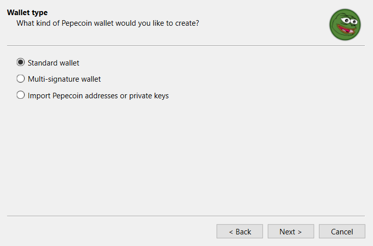
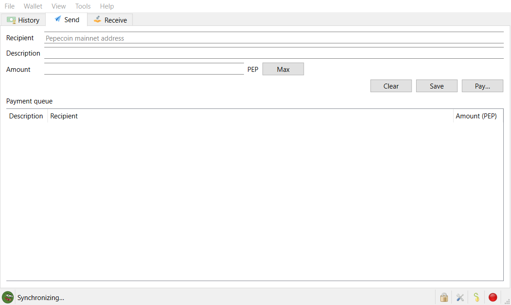

# Electrum-PEP

Electrum-PEP is an independent Windows desktop wallet for Pepecoin (PEP) mainnet. It uses Python, Qt and components from the Electrum Bitcoin wallet. It connects to Pepecoin Electrum servers over TLS. The server supplies history and confirmations. The wallet checks the network genesis and does not independently validate the full header chain for each transaction.

## Windows downloads

Download the [latest Windows release](https://github.com/AltForger/Electrum-PEP/releases/latest).

- **Setup** installs the wallet for the current Windows user. Wallet data lives in `%LOCALAPPDATA%\Electrum-PEP`.
- **Portable** runs directly from a writable folder. Keep the executable beside its existing `Electrum-PEP-data` folder when updating.

The Windows x64 downloads are unsigned.

Since 0.5.5, opening a wallet checks GitHub for a newer stable release. A button above the tabs opens that release in your browser. The check repeats every six hours while the wallet is open, or after one hour if GitHub is unavailable. Installation is manual.

Create a wallet or restore an existing one in the startup wizard. Back up the recovery information for your wallet type before receiving funds. Use **Network** to inspect or select an Electrum server.

## Wallet interface

To freeze a specific unspent output, enable **View → Coins** and tick **Frozen** on its row. Clear the checkbox to spend it again. Frozen PEP stays in the balance. Payments and **Max** use only unfrozen outputs. Freeze selections are saved in the encrypted wallet file and its backups; restoring only the seed creates a fresh selection.

The wallet follows the Windows display-language preference at startup. It uses the first supported language in that list and falls back to English. The interface includes 57 languages and regional or script variants. Translations are bundled with the application and work offline. The screenshots below show the English interface.

Choose a standard wallet, a multisignature wallet, or import Pepecoin addresses and private keys in the setup wizard.



The Send tab includes the recipient, description and PEP amount, along with saved payment drafts.



## Build the Windows release

Use Windows x64, 64-bit Python 3.13, a MinGW-w64 x86-64 GCC toolchain and NSIS 3 with the Russian and English Modern UI language files. Put GCC and makensis on PATH or pass their full paths to the build script.

```powershell
py -3.13 -m venv .venv
.\.venv\Scripts\python.exe -m pip install -r requirements-win64.lock
.\build-windows.ps1
```

The build fetches the pinned libsecp256k1 sources and verifies their SHA-256 before compiling. It runs the offline tests, builds both wallet binaries and packages the installer in the versioned directory under `dist`. The version used by Qt, the network client, Windows file properties and the installer is defined in `pep_version.py`.

## Licenses and sources

The AltForge application code is licensed under the [MIT License](LICENSE). The Windows distribution includes GPLv3 PyQt6 and other third-party components. The combined distribution is provided under GPLv3, with each component retaining its own license. See [dependency sources and versions](DEPENDENCIES.md) and the [license texts](licenses/).

Interface translations include strings from the Electrum 4.8.4 locale catalogs and machine-assisted translations for wallet-specific terms. Corrections to individual languages are welcome.
